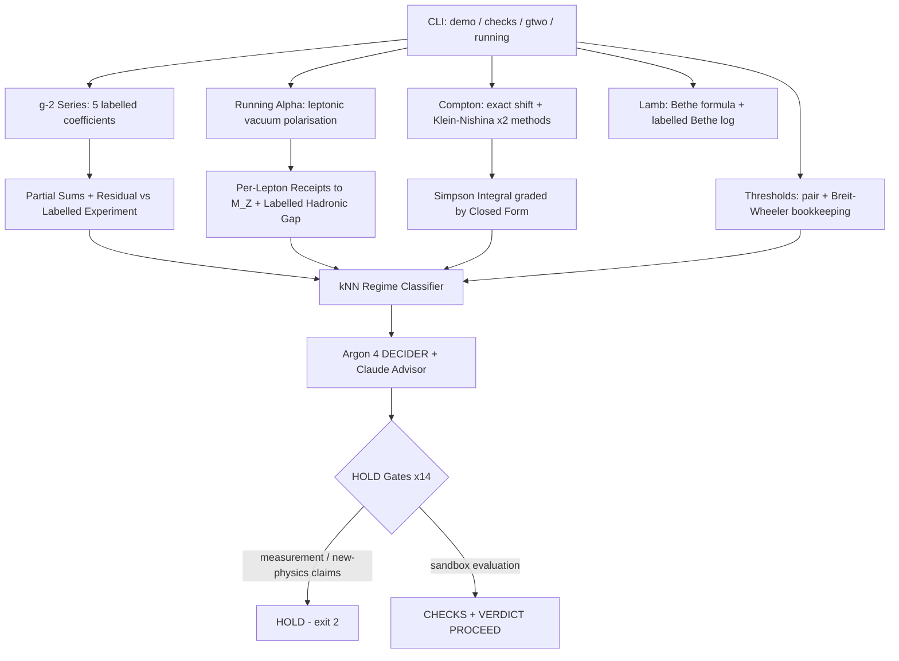
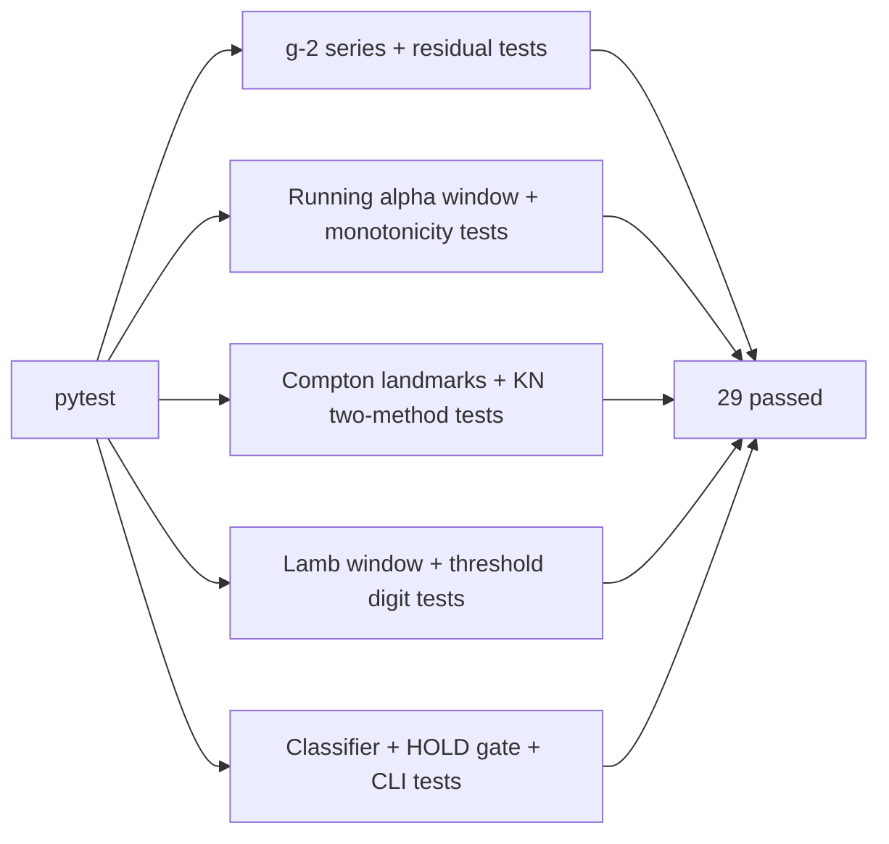
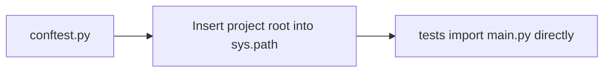
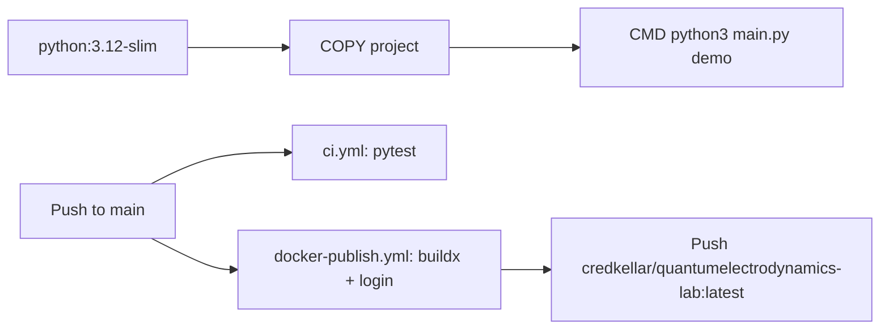

# QuantumElectrodynamics-Lab ⚛️✨

**QED Precision Quantities Lab — g-2, Running α, Klein–Nishina, Lamb Shift & Thresholds** — by Darion Kellar

QuantumElectrodynamics-Lab is an **educational quantum-electrodynamics lab** in ONE pure-Python file. It evaluates the classic precision quantities of QED from **labelled input constants**, and grades every headline number against something independent: the electron g−2 series is summed term by term from the published coefficients and compared with the labelled experimental value; the running of α is computed lepton by lepton up to the Z pole; the Klein–Nishina total cross section is computed **two ways** — a Simpson integral of the differential formula and the closed form — and the two are asserted to agree; Bethe's 1947 Lamb-shift estimate is printed beside the measured value with its gap labelled as the known shortfall; and the pair-production thresholds are pure bookkeeping from m_e c², asserted digit by digit.

Honest scope, stated up front: every constant and every published coefficient is a **labelled input**, and the experimental values are labelled references — **nothing here is a measurement**. Where a piece of the full answer is not computed (hadronic vacuum polarisation, mass-dependent and weak g−2 terms, relativistic Lamb corrections), the lab prints it as a **labelled missing piece with its size**, so the gap is visible, never hidden. A small residual is arithmetic, not a discovery: every measurement / new-physics / vendor claim sits behind a permanent HOLD gate (14 total). 🔒

[](https://github.com/kimanicollier44-cmyk/QuantumElectrodynamics-Lab/actions/workflows/ci.yml)
[](https://github.com/kimanicollier44-cmyk/QuantumElectrodynamics-Lab/actions/workflows/docker-publish.yml)

> ℹ️ These are the **live** workflow badges for this repo. They activate as soon as the `ci.yml` and `docker-publish.yml` files from the paste pack are pasted into `.github/workflows/` — until then they have nothing to report yet.

## 🧰 Tech Stack Badges & Full Architecture Tech Stack

### 💻 Core Programming Languages & Core Systems


- 🐍 Python 3.12, pure standard library (`math`, `cmath`, `hashlib`, `json`, `sys`) — zero dependencies, zero network, deterministic (double-run byte-identical)
- ✨ g−2 core: the five published mass-independent coefficients (labelled inputs) evaluated as C_n·(α/π)ⁿ with partial sums, term ratios, and the residual against the labelled experimental value — every step asserted in CHECKS
- 🏃 Running-α core: one-loop leptonic vacuum polarisation Δα_lep = (α/3π)·Σ_l [ln(Q²/m_l²) − 5/3] with a stated threshold guard (a lepton counts only above Q > 2m_l), per-lepton receipts, and the hadronic piece printed as a labelled missing input — never computed, never hidden
- 🎯 Compton core: the exact shift Δλ = λ_C(1 − cos θ) plus the Klein–Nishina total cross section computed **twice** — Simpson integration (2,880 slices) of the differential formula and the closed form — with agreement asserted, so the integral is graded, not trusted
- 🐑 Lamb core: Bethe's nonrelativistic formula with the labelled Bethe logarithm ln K₀(2S) = 2.8117695, its ~1% shortfall against the labelled measured value printed as the known gap, not as agreement
- 🧠 TinyML kNN regime classifier (from scratch, stdlib, distance-weighted): precision-agreement / running-coupling-regime / classical-limit / threshold-blocked from residual ppm + Δα % + σ/σ_T + E/E_threshold, labels from the lab's own policy
- 🪑 Council seats: Gemini Argon 4 DECIDER (names-only, tighten-only) + Muse advisor (never overrides HOLD) + Google Flow plan-only (rendered = False, live = 0)

### ⛓️ Web3 & Infrastructure

- 🚫 **Not applicable — honestly.** No blockchain, no Web3, no tokens: the "infrastructure" in this lab is one offline file holding a power series, a logarithm sum, and an angular integral. Precision-measurement and metrology claims are permanent HOLD gates, not features. No fake badges here.

### ⚙️ Platform Support & Hardware Architecture


- 🖥️ Pure Python — runs anywhere Python 3.12+ runs (Linux, macOS, Windows), plus the `python:3.12-slim` Docker image
- 🔒 No hardware is controlled, ever: real accelerators, detectors, lasers, and magnets are permanent HOLD gates (see the gate table below)

### ⚡ Low-Level Infrastructure & Performance

- 🚫 **No low-level code — honestly.** No C, no C++, no GPU, no compiled extensions: this is one interpreted Python file on purpose, so every term can be read, checked, and diffed. Performance here means honest algorithms — a 2,880-slice Simpson integration refereed by a closed form, bisection-free threshold bookkeeping that is exact by construction — all deterministic and byte-identical between runs.

### 🛠️ DevOps & Build Tools


- 🐳 Docker (`python:3.12-slim`), GitHub Actions CI + Docker Publish (delivered in the paste pack)
- 🎯 Target image: `credkellar/quantumelectrodynamics-lab:latest`
- 🧪 Tests: `pytest` (29 tests) + the built-in CHECKS suite (55 checks) in `main.py`

### ☁️ Cloud Providers

- 🚫 **None — honestly.** No cloud provider is used or needed: the lab runs fully offline on your own machine or in a local Docker container. Docker Hub appears only as the registry the publish workflow pushes the image to.

## What this does?

1. 🏷️ **Labelled inputs, derived constants** — α⁻¹(0) = 137.035999084, the lepton masses, M_Z, h, c, e are stated once as labelled inputs; everything else (α, λ_C = 2.4263102387 pm, r_e, σ_T = 0.66524587 barn, m_e c² = 0.510998950 MeV) is computed from them and asserted in CHECKS.
2. ✨ **Electron g−2, order by order** — with α/π = 0.002322819466, the five published terms land at +1.161410e-03, −1.772305e-06, +1.480420e-08, −5.566799e-11, +4.555582e-13. The first term is Schwinger's α/(2π) = 0.001161409732886, matched to machine precision; each later term is under 1% of the previous one (ratios 0.00153 / 0.00835 / 0.00376 / 0.00818), asserted, not assumed.
3. 🎯 **The total and its honest residual** — the five-loop mass-independent sum is **0.001159652176814** against the labelled experimental **0.00115965218073**: a residual of **−3.916e-12 (−0.003377 ppm)**. The report prints what is NOT in the coefficients — mass-dependent QED terms, the hadronic ~1.7e-12, the weak ~3e-14, and α's own input uncertainty — because that list *is* the explanation of the residual.
4. 🏃 **Running of α, lepton by lepton** — Δα_lep(M_Z²) = **0.031421**, receipted as electron 0.017435 + muon 0.009178 + tau 0.004808, so α⁻¹ falls from 137.036 at Q = 0 to **132.7302** at the Z pole on leptonic running alone, monotonically down a five-rung ladder to 131.2056 at 1 TeV.
5. 🧩 **The hadronic gap, printed** — the hadronic vacuum polarisation is **not computed**; it enters only as the labelled input 0.02766, giving the full on-shell α⁻¹(M_Z) = **128.9398**. The often-quoted 127.95 is flagged as the MS-bar convention value — labelled, not computed — so three different-looking numbers never get blurred into one.
6. 💥 **Compton shift, exact** — Δλ = λ_C(1 − cos θ): 0 at 0°, 2.426310 pm at 90°, 4.852620 pm at 180°, monotone in angle, each landmark asserted against λ_C itself.
7. 📐 **Klein–Nishina, graded two ways** — the total cross section at x = E/(m_e c²) is integrated numerically (Simpson, 2,880 slices) *and* evaluated from the closed form; they agree to better than 1e-8 relative at x = 0.01, 1, and 10. σ/σ_T falls 0.998005 → 0.980507 → 0.841338 → **0.430728** → **0.122760** across x = 0.001…10, approaching the Thomson limit from below as x → 0.
8. 🐑 **Lamb shift, Bethe's way** — the Bethe logarithm (labelled) gives K₀ = 226.3897 eV and the nonrelativistic estimate **1047.4230 MHz** against the labelled measured **1057.84 MHz** — a **0.9847% gap**, printed as the known shortfall of the 1947 estimate (relativistic, recoil, and higher-order radiative pieces are not in Bethe's formula). Only the few-% window is asserted.
9. ⚡ **Thresholds as bookkeeping** — γ → e⁺e⁻ needs 2m_e c² = **1.021997900 MeV** (digits asserted); Breit–Wheeler head-on pairs need E₁·E₂ ≥ (m_e c²)² = 0.261119927 MeV², with the symmetric point at E₁ = E₂ = 0.510999 MeV and sub-threshold pairs flagged blocked.
10. 🏷️ **Regime classifier + seats + checks** — a from-scratch distance-weighted kNN labels probe points precision-agreement (the g−2 probe), running-coupling-regime (the M_Z and hard-scattering probes), classical-limit (the Thomson probe), and threshold-blocked (the sub-threshold photon), with Argon 4 DECIDER (sha256 trace), Muse advisor, Google Flow plan-only, and a built-in CHECKS suite (55 checks).

## 🗺️ How it works — diagram per script

### `main.py` — the whole lab



### `tests/test_main.py` — verification



### `conftest.py` — test path setup



### `Dockerfile` + CI flow — container & publish



## Why is this cool?

1. ✨ The most precise agreement in physics, **recomputed on a laptop**: five terms and a labelled α land 0.0034 ppm from the measured g−2 — and the lab shows every rung of the ladder instead of quoting the landing.
2. 🪜 The series *shows its own convergence*: each term is under 1% of the one before (the worst ratio is 0.00835), so you can watch five loops buy eleven decimal places.
3. 🏃 α is not a constant and the lab proves it with receipts: electron, muon, and tau contributions itemised (0.017435 / 0.009178 / 0.004808) as α⁻¹ slides 137.036 → 132.73 on the way to the Z pole.
4. 🧩 The missing physics is **printed, not buried**: the hadronic gap beside α(M_Z), the mass-dependent terms beside the g−2 residual, the relativistic corrections beside Bethe's number — every caveat has a size.
5. 📐 The Klein–Nishina integral is **refereed by its own closed form**: two independent computations asserted to agree below 1e-8, so the numerics earn trust instead of asking for it.
6. 🐑 A 1947 back-of-envelope lands within 1% of a modern precision value — Bethe's estimate (1047.42 MHz vs 1057.84 MHz) is reproduced exactly, gap and all, as a lesson in what an approximation is worth.
7. ⚡ Thresholds are bookkeeping you can check digit by digit: 1.021997900 MeV for pair production, and the Breit–Wheeler product rule with its elegant symmetric point at 0.510999 + 0.510999 MeV.
8. 🏷️ Three famous numbers that look alike are kept apart: 132.73 (leptonic only), 128.94 (full on-shell, with the labelled hadronic input), 127.95 (MS-bar convention) — the lab never lets them blur.
9. 🎯 The Thomson limit is approached, not asserted: σ/σ_T = 0.998005 at x = 0.001, 0.980507 at x = 0.01 — classical physics recovered as the low-energy edge of the quantum formula.
10. 🔁 Deterministic end to end: run it twice, get byte-identical output — a QED evaluation you can diff.

## What problems this solves?

1. ❌ **Problem:** g−2 is quoted as a magic decimal with no visible structure. ✅ **Solution:** The five terms, partial sums, and term ratios are printed rung by rung, with Schwinger's α/(2π) identified as rung one.
2. ❌ **Problem:** Residuals against experiment get hyped as new physics. ✅ **Solution:** The −0.003377 ppm residual is printed next to the itemised list of pieces not in the coefficients, and `new_physics_claim` is a permanent HOLD gate.
3. ❌ **Problem:** "α = 1/137" is taught as a constant of nature, full stop. ✅ **Solution:** The leptonic running is computed on a five-rung ladder with per-lepton receipts — the coupling demonstrably runs.
4. ❌ **Problem:** α(M_Z) values from different conventions get mixed up (128.9? 127.95? 132.7?). ✅ **Solution:** All three are printed with their exact provenance: computed leptonic-only, full on-shell with a labelled hadronic input, and the labelled MS-bar value.
5. ❌ **Problem:** The hadronic contribution is silently included or silently dropped. ✅ **Solution:** It is a named, labelled input (0.02766) used in exactly one printed line and flagged everywhere else as not computed.
6. ❌ **Problem:** Numerical integrals in teaching code are trusted because they print a plausible number. ✅ **Solution:** The Klein–Nishina Simpson integral is asserted against the closed form at three energies before any ratio is quoted.
7. ❌ **Problem:** The Lamb shift is presented as a single received number. ✅ **Solution:** Bethe's estimate is derived from the Bethe logarithm in the open, and its 0.9847% gap is labelled as the known shortfall with the missing pieces named.
8. ❌ **Problem:** Pair-production thresholds get rounded into mush ("about an MeV"). ✅ **Solution:** The threshold is computed from m_e c² and asserted to the digit (1.021998 MeV), with the Breit–Wheeler product rule gridded.
9. ❌ **Problem:** Constants in student code appear from nowhere. ✅ **Solution:** Every constant is a labelled input in one block at the top of the file, and every derived constant is computed from them in the open.
10. ❌ **Problem:** Simulation tools quietly imply a measurement happened. ✅ **Solution:** 14 named HOLD gates return exit code 2 for every measurement, metrology, vendor, or hardware claim, forever.

## How to install this?

1. 📋 Clone or download this project folder.
2. 🐍 Make sure Python 3.12+ is installed: `python3 --version`
3. ▶️ Run the full demo + checks (no arguments needed):

```bash
python3 main.py
```

4. 🧪 Run the test suite:

```bash
pip install pytest
python3 -m pytest -q
```

5. 🎛️ Try the other commands:

```bash
python3 main.py checks      # 55 built-in checks
python3 main.py gtwo        # g-2 series: terms, partial sums, residual (JSON)
python3 main.py running     # leptonic running to M_Z + labelled hadronic gap (JSON)
python3 main.py compton     # Compton shift table + Klein-Nishina ladder (JSON)
python3 main.py lamb        # Bethe Lamb-shift estimate vs labelled measured (JSON)
python3 main.py thresholds  # pair + Breit-Wheeler threshold bookkeeping (JSON)
python3 main.py classify    # kNN regime classifier report
python3 main.py brains      # Argon 4 + Muse + Flow seats
python3 main.py holds       # list all 14 HOLD gates
python3 main.py hold-demo   # exits 2 - gated actions stay HOLD
```

6. 🐳 Or run it in Docker:

```bash
docker build -t credkellar/quantumelectrodynamics-lab:latest .
docker run --rm credkellar/quantumelectrodynamics-lab:latest
```

## Requirements

- 🐍 Python 3.12 or newer
- 📦 Dependencies: **none** (standard library only)
- 🌐 Network: **none** — fully offline
- 🧪 For tests only: `pytest`
- 🐳 Optional: Docker

## FULL project structure tree

```text
quantumelectrodynamics-lab/
├── main.py                  # the whole lab: labelled constants, g-2 series, running alpha, Compton + Klein-Nishina, Bethe Lamb shift, thresholds, classifier, seats, HOLD gates
├── conftest.py              # puts the project root on sys.path for tests
├── tests/
│   └── test_main.py         # 29 pytest tests: g-2, running, Compton/KN, Lamb, thresholds, classifier, gates, CLI, determinism
├── assets/
│   └── cover.png            # README cover image (2736 x 912)
├── Dockerfile               # python:3.12-slim, runs the demo
├── .gitignore               # __pycache__/, .pytest_cache/, *.pyc
└── README.md                # this file
```

> 📦 Delivered separately as paste packs (not in this tree): `.github/workflows/ci.yml` + `docker-publish.yml`, and the Docker Hub pack (100-char description, 350-char About, overview, categories).

## 🔒 HOLD gates — all 14, permanent

| # | Gate | What stays held |
|---|------|-----------------|
| 1 | `precision_measurement_claim` | No new precision measurement of α, g−2, or any constant; inputs are labelled references |
| 2 | `new_physics_claim` | No new-physics or beyond-Standard-Model claim; a series residual is arithmetic, not a discovery |
| 3 | `constant_redefinition_claim` | No redefining CODATA constants; formulas are evaluated at labelled input values |
| 4 | `metrology_certification_claim` | No metrology certification or traceability claim for any computed number |
| 5 | `vendor_claim` | No vendor, instrument, or product claims from textbook evaluations |
| 6 | `hardware_spec_claim` | No hardware specifications for accelerators, detectors, lasers, or magnets |
| 7 | `experimental_design_claim` | No claim that these evaluations design or validate a real experiment |
| 8 | `medical_claim` | No medical imaging, therapy, or dosimetry claims from Compton or pair-production math |
| 9 | `radiation_safety_claim` | No radiation-safety, shielding, or exposure certification |
| 10 | `weapons_claim` | No weapons-related use of cross sections or pair-production thresholds |
| 11 | `live_radiation_monitoring` | No live radiation monitoring or dosimetry use |
| 12 | `data_fabrication_claim` | Computed values are never presented as measured data |
| 13 | `publication_claim` | No claim of publishable new results; these are textbook evaluations |
| 14 | `investment_claim` | No investment claims; a lab model is not a prospectus |

🧑‍⚖️ **Council seats:** Gemini Argon 4 Extended Thinking — DECIDER (model id `gemini-argon-4`, names-only, tighten-only, MAP → MODEL → STRESS → DECIDE, sha256 trace, `can_override_hold = False`) · Muse — advisor (`can_override_hold = False`) · Google Flow — plan-only (`rendered = False`, `live = 0`).

✅ **Verification:** pytest **29 passed** (project + clean copy) · built-in CHECKS **55/55** · double-run output **byte-identical** · `hold-demo` exits **2** · `main.py` **770 lines**, pure stdlib, zero network.

## 🧒 5th-grade English section

Imagine the tiniest magnet in the world: one electron, spinning like a top. Scientists can measure how strong that tiny magnet is to an amazing number of decimal places — and they can also *calculate* it, using one of the hardest math toolboxes ever built, called QED. This lab does the calculating part, step by step. ✨

- The answer is built like a tower of smaller and smaller bricks. The first brick is easy (a scientist named Schwinger found it in 1948 and was so proud he had it carved on his gravestone!). Each next brick is about a hundred times smaller than the one before. After five bricks, the tower matches the measured answer to **eleven decimal places** — the leftover difference is smaller than the size of the pieces the lab honestly says it left out. 🧱
- One of the numbers in the math, called α, is **not really constant** — it slowly changes when particles zoom around at higher energies, like a rule that depends on how fast the game is played. The lab adds up the electron, muon, and tau contributions one at a time and shows α changing, step by step. 🏃
- When light bounces off an electron, it comes back stretched — the faster the bounce angle, the more it stretches. The lab computes that stretch, and computes the total bounce chance **two different ways** to make sure both answers agree. 💥
- A famous scientist named Bethe once estimated a tiny energy shift in hydrogen on the back of an envelope in 1947. The lab repeats his estimate and gets within **1%** of the modern measured answer — and says plainly why the last 1% needs fancier math. 🐑
- This project is a **pretend lab on a computer**. It does not measure anything real. It helps you learn how the most precise theory in all of science keeps its receipts. 💻

---

MIT © 2026 Darion Kellar · QuantumElectrodynamics-Lab — educational simulation only ⚛️
